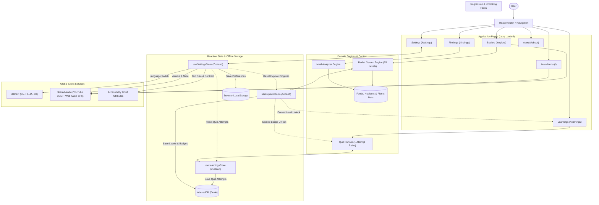

# SYLVARA

> **"Every meal uncovers a tale, and every tale opens a new world."**

SYLVARA is an interactive, gamified educational web application designed to transform how learners explore food, micronutrients, botanical lore, and public health awareness. Built with a modern dark-lavender aesthetic, tactile micro-animations, and an atmospheric soundscape, SYLVARA replaces anxiety-inducing calorie counting and sterile charts with visual discovery, scenario-based garden exploration, educational dossiers, and badge-linked quizzes.

---

## Table of Contents

- [1. Project Identity](#1-project-identity)
- [2. Project Description](#2-project-description)
- [3. Purpose & Problem Statement](#3-purpose--problem-statement)
- [4. What SYLVARA Does](#4-what-sylvara-does)
  - [4.1 Main Menu](#41-main-menu)
  - [4.2 Findings (Meal & Nutrient Discovery)](#42-findings-meal--nutrient-discovery)
  - [4.3 Explore (25-Level Radial Garden Game)](#43-explore-25-level-radial-garden-game)
  - [4.4 Learnings & Quizzes](#44-learnings--quizzes)
  - [4.5 Settings](#45-settings)
  - [4.6 About](#46-about)
- [5. What It Teaches](#5-what-it-teaches)
- [6. Learning Progression & Rewards](#6-learning-progression--rewards)
- [7. Key Features](#7-key-features)
- [8. Application Architecture](#8-application-architecture)
  - [8.1 Architecture Flowchart](#81-architecture-flowchart)
- [9. Technology Stack](#9-technology-stack)
- [10. Project Directory Structure](#10-project-directory-structure)
- [11. Installation & Setup](#11-installation--setup)
- [12. Available Commands](#12-available-commands)
- [13. Data, Privacy & Storage Architecture](#13-data-privacy--storage-architecture)
- [14. Limitations & Responsible Use](#14-limitations--responsible-use)
- [15. Credits & Acknowledgements](#15-credits--acknowledgements)
- [16. Future Scope](#16-future-scope)
- [17. License](#17-license)

---

## 1. Project Identity

- **Project Name:** SYLVARA
- **Official Tagline:** _"Every meal uncovers a tale, and every tale opens a new world."_
- **Domain:** Interactive Gamified Nutrition & Botanical Education / Digital Health Awareness
- **Visual Identity:** Cinematic dark theme (`#07050a`), deep-violet and lavender gradients (`#c084fc`, `#a855f7`), translucent glassmorphism surfaces, subtle glowing borders, and serif typography (`Cinzel` & `Cormorant Garamond`).

---

## 2. Project Description

SYLVARA is a frontend-only, offline-first digital learning experience that invites users into an enchanting universe where meals, medicinal herbs, and biological nutrients tell interconnected stories. Instead of treating nutrition as an exercise in calorie restriction or clinical guilt, SYLVARA reframes food as cultural heritage, cellular nourishment, and preventative health awareness.

Through its illustrated 2D garden and interactive discovery tools, users can analyze staple meals to reveal their nutrient synergies, solve 25 progressive clinical-botanical scenarios in an interactive garden, unlock deep educational dossiers, and test their comprehension in single-attempt badge quizzes.

> [!NOTE]
> SYLVARA is strictly an educational awareness companion. It is **not** a medical diagnosis tool, treatment platform, clinical prescription engine, or calorie-counting app.

---

## 3. Purpose & Problem Statement

### The Problem

Traditional nutrition education and digital diet apps suffer from persistent structural shortcomings:

1. **Hyper-Quantification & Anxiety:** Most mainstream tools focus compulsively on calorie counting, macro ratios, and numerical targets, which research links to dietary fatigue and disordered eating patterns.
2. **Clinical Inaccessibility:** Medical and biochemical literature on vitamins, minerals, and phytochemicals is frequently buried under intimidating scientific jargon that alienates everyday learners.
3. **Disconnection from Nature:** Modern consumers often know little about the raw plants, culinary herbs, and whole foods that yield essential nutrients, severing the link between agricultural ecology and personal wellbeing.
4. **Misinformation & Risky Self-Medication:** The rise of unverified online health trends has increased indiscriminate supplement use, confusion around herbal remedies, and rampant antibiotic misuse for viral conditions.

### The SYLVARA Approach

SYLVARA bridges gastronomy, botanical science, and public health through playful exploration:

- **Story over Stats:** Replaces numerical targets with qualitative dietary harmony and food group synergy.
- **Interactive Garden Metaphor:** Connects active biochemicals (e.g., curcumin in turmeric, eugenol in holy basil) directly to living plants in an illustrated radial environment.
- **Responsible Health Awareness:** Distinguishes traditional plant lore from evidence-based medicine and certified pharmacology, actively teaching antibiotic stewardship and safe health practices.
- **Gamified Mastery:** Rewards curious investigation with unlockable learning cards and progressive knowledge badges.

---

## 4. What SYLVARA Does

The application consists of six fully realized, interconnected main pages accessible from the root router:

```
┌─────────────────────────────────────────────────────────────┐
│                          MAIN MENU                          │
├─────────────┬─────────────┬─────────────┬─────────────┬─────┴───────┐
│  FINDINGS   │   EXPLORE   │  LEARNINGS  │  SETTINGS   │    ABOUT    │
└─────────────┴─────────────┴─────────────┴─────────────┴─────────────┘
```

### 4.1 Main Menu

The atmospheric gateway to SYLVARA:

- **Cinematic Atmosphere:** Fullscreen looping background video (`menu-bg.mp4`) overlaid with radial vignettes.
- **Ambient Soundtrack:** Integrated YouTube audio controller streaming _"Crosses"_ by José González at a gentle, slowed playback rate (0.8x) with global mute and volume controls.
- **Centerpiece Visual:** Illustrated floating Buddha bowl symbolizing dietary balance and culinary diversity.
- **Five Primary Portals:** Direct access to _Findings_, _Explore_, _Learnings_, _Settings_, and _About_ with synthesized tactile audio feedback on hover and selection.

### 4.2 Findings (Meal & Nutrient Discovery)

An intuitive meal exploration tool:

- **Natural Language Meal Entry:** Users enter everyday meals (e.g., _"Poha"_, _"Dal Tadka with Roti"_, _"Moong Dal Chilla"_, _"Palak Paneer"_, _"Mediterranean Salad"_).
- **Intelligent Ingredient Parser:** Normalizes meal queries and matches verified ingredients against a curated database of global and Indian culinary staples (`foodsData.ts`).
- **Circular Nutrient Wheel:** Visualizes the meal's verified micronutrients and active compounds across color-coded categories (Vitamins, Minerals, Macronutrients, Phytochemicals).
- **Nutrient Drill-Down Dossiers:** Clicking any node on the wheel or in the supported list opens an evidence-based detail card revealing cellular roles, food sources, and botanical synergies.
- **Nutritional Balance & Gaps:** Gently surfaces underrepresented components (e.g., suggesting a citrus squeeze to boost iron absorption from lentils) and recommends complementary whole foods without ever calculating calories or grams.
- **Nutritional Profile Graph:** Displays a qualitative multidimensional overview of the meal's dietary harmony.

### 4.3 Explore (25-Level Radial Garden Game)

A 25-level scenario-driven botanical puzzle game:

- **Scenario-Based Objectives:** Each level presents an authentic health or environmental scenario (e.g., Level 1: Common Cold & Respiratory Congestion; Level 5: Fatigue & Iron Absorption; Level 12: Bone Density Support; Level 25: Master Botanical Synthesis).
- **Radial Garden Arena:** Interactive botanical and dietary specimens arranged in a dynamic radial geometry with viewport-aware hover tooltips and tactile selection mechanics.
- **Validation Engine:** Evaluates selected remedies against the scenario's requirements. Correct solutions trigger level completion; incorrect submissions provide constructive guidance with retries.
- **Progressive Difficulty Tiers:** Levels are grouped into progressive difficulty tiers (_Apprentice_, _Herbalist_, _Alchemist_, _Botanical Sage_) with celebratory transition screens.
- **In-Game Assistance:** Contextual hint modals and an integrated _How to Play_ guide accessible at any moment.

### 4.4 Learnings & Quizzes

A dedicated educational repository earned through gameplay:

- **Earned Learnings Section:** Unlocks permanent educational lesson cards upon completing Explore levels. Each card expands into a structured clinical dossier covering topic definitions, contributing factors, active nutrients/compounds, evidence-based benefits, supportive care, and when to seek certified medical attention.
- **Badge-Linked Quizzes Section:** Displays 25 quizzes unlocked exclusively by earning the corresponding badge in Explore.
- **Three-Question Runner:** Each quiz features exactly three multiple-choice questions assessing comprehension, safe practices, and nutrient knowledge.
- **Strict One-Attempt Rule:** Quizzes enforce a single attempt per unlock, encouraging focused attention and mindful learning.
- **Instant Detailed Review:** Learners receive immediate rationales and takeaways for every question, followed by a permanent score summary.

### 4.5 Settings

A unified settings dashboard featuring 7 dedicated sections:

- **Profile:** Custom username editing and selection across 6 illustrated avatar archetypes (_The Seeker_, _The Herbalist_, _The Alchemist_, _The Botanist_, _The Sage_, _The Druid_), plus live milestone statistics from Explore and Learnings.
- **Controls:** An illustrated guide demonstrating the core interaction philosophy: _"Hover helps users discover more. Clicking helps users explore detailed information."_ Includes an interactive live sandbox featuring _Sacred Tulsi (Holy Basil)_.
- **Language:** Instant interface translation across 4 languages (**English**, **हिन्दी**, **日本語**, **简体中文**) without requiring a page refresh.
- **Audio & Volume:** Independent volume sliders (0–100%) and mute toggles for atmospheric background music and tactile Web Audio sound synthesis, plus a test tone trigger.
- **How to Play:** Comprehensive 6-part gameplay guide perfectly synchronized with Explore's in-game guide.
- **Accessibility:** Reduced motion toggle (disabling particle waves and rotations), typography scaling (Compact, Standard, Enlarged), and high contrast mode.
- **Data & Progress:** Transparent local storage overview (IndexedDB + LocalStorage) and an isolated Explore reset option that relocks game progression while preserving all player preferences.

### 4.6 About

A comprehensive developer showcase and educational manifesto detailing:

- The origin story and inspiration behind SYLVARA.
- Core design philosophy and accomplishments.
- Technical challenges overcome during development.
- Key lessons learned in client-side architecture.
- Future developmental roadmap.
- Complete creator and music credits.

---

## 5. What It Teaches

SYLVARA translates scientific botany, food chemistry, and public health awareness into five interconnected educational pillars:

### Pillar A: Food Groups & Dietary Synergy

- Understanding how whole foods harmonize in a complete meal.
- Learning about dietary balance and identifying underrepresented food groups without restrictive caloric metrics.
- Exploring complementary combinations (e.g., Vitamin C pairing with plant-based Non-Heme Iron to enhance bioavailability).

### Pillar B: Essential Nutrients & Biological Functions

- **Vitamins:** Enzymatic cofactors, antioxidant defense (Vitamin C, Vitamin A, Vitamin E), and immune regulation (Vitamin D).
- **Minerals:** Structural and metabolic elements (Calcium, Magnesium, Zinc, Iron, Potassium).
- **Proteins & Amino Acids:** Cellular repair, muscular maintenance, and enzymatic synthesis.
- **Complex Carbohydrates & Dietary Fibre:** Prebiotic microbiome support, digestive rhythm, and steady glycemic release.
- **Healthy Lipids:** Polyunsaturated and monounsaturated fatty acids supporting cell membrane integrity and fat-soluble vitamin uptake.

### Pillar C: Botanical Knowledge & Phytochemicals

- Demystifying culinary herbs and medicinal plants:
  - **Turmeric (_Curcuma longa_):** Active curcuminoids and anti-inflammatory properties; enhanced absorption via piperine in black pepper.
  - **Holy Basil / Tulsi (_Ocimum sanctum_):** Eugenol and adaptogenic flavonoids easing respiratory stress.
  - **Ginger (_Zingiber officinale_):** Gingerols supporting gastrointestinal motility and nausea relief.
  - **Spearmint / Peppermint (_Mentha_):** Menthol aiding smooth muscle relaxation.
- Appreciating cultural culinary traditions while grounding claims in peer-reviewed science.

### Pillar D: Medicine Literacy & Public Health Safety

- **Active Ingredients vs. Crude Herbs:** Understanding how pharmaceutical drugs are standardized, titrated, and rigorously tested under clinical protocols.
- **Dangers of Self-Medication:** Recognizing the severe risks of consuming unverified remedies or delaying clinical intervention.
- **Antibiotic Stewardship:** Clarifying that antibiotics target bacterial pathogens and are completely ineffective against viral colds and influenza; highlighting the global challenge of antimicrobial resistance (AMR).
- **"Natural" Does Not Mean Harmless:** Dispelling the myth that botanical compounds cannot cause toxicity, organ strain, or dangerous drug-herb interactions.

### Pillar E: Mindful Food Awareness & Responsible Choices

- Encouraging conscious ingredient selection and culinary enjoyment.
- Celebrating meals as cultural storytelling and preventative vitality.
- Clearly teaching when symptoms require prompt, certified clinical diagnosis.

---

## 6. Learning Progression & Rewards

SYLVARA features a cohesive, dual-loop progression system that tightly couples puzzle-solving in **Explore** with permanent knowledge mastery in **Learnings**:

```
┌─────────────────┐       Level Pass        ┌─────────────────┐
│     EXPLORE     │ ──────────────────────> │  LEARNING CARD  │
│    25 Levels    │                         │  Unlocks Lesson │
└────────┬────────┘                         └─────────────────┘
         │
         │ Earns Badge
         v
┌─────────────────┐       Unlocks Quiz      ┌─────────────────┐
│  EARNED BADGE   │ ──────────────────────> │ 3-QUESTION QUIZ │
│   25 Unique     │                         │ 1 Attempt Only  │
└─────────────────┘                         └────────┬────────┘
                                                     │
                                                     │ Scored
                                                     v
                                            ┌─────────────────┐
                                            │ PERMANENT SCORE │
                                            │ Mastered Rating │
                                            └─────────────────┘
```

### Progression Mechanics

1. **Explore Level Progression:** Users advance through 25 sequential levels across difficulty tiers. Level completion unlocks both the next level and an in-depth **Learning Card**.
2. **Badge Unlocks:** Successfully solving a level awards its corresponding thematic badge (e.g., _Respiratory Shield_, _Vitality Ember_, _Bone Fortress_).
3. **Quiz Unlocking:** Each of the 25 quizzes in the Learnings section remains strictly locked until its corresponding badge is earned in Explore.
4. **The One-Attempt Rule:** Each quiz can only be attempted once per unlock, emphasizing thoughtful deliberation rather than trial-and-error guessing.
5. **Standardized Scoring System:** Every quiz consists of exactly 3 questions. Results are permanently stored according to the following criteria:

|   Score   | Result Category            | Meaning & Pedagogical Feedback                                                 |
| :-------: | :------------------------- | :----------------------------------------------------------------------------- |
| **0 / 3** | **Better Luck Next Time!** | Core concepts need further review; detailed rationales are provided for study. |
| **1 / 3** | **Learning**               | Foundation established; learner grasped one key concept.                       |
| **2 / 3** | **Well Explored**          | Strong comprehension of primary botanical mechanisms and safe practices.       |
| **3 / 3** | **Mastered**               | Flawless understanding of nutrients, synergies, and clinical precautions.      |

### Explore Reset Behaviour

In the Settings page under _Data & Progress_, players can trigger **Reset Explore Progress**. This operation:

- Relocks Explore levels 2–25 and resets level progression back to Level 1.
- Clears earned badges, learning cards, and dependent quiz attempt records.
- **Preserves Player Preferences:** Username, chosen avatar, language selection, music/SFX volume, mute toggles, and accessibility configurations remain completely untouched.

---

## 7. Key Features

- **Scenario-Based Radial Gameplay:** 25 handcrafted botanical scenarios rendered in a responsive radial layout with dynamic hover previews and selection validation.
- **Deep Educational Dossiers:** 25 structured lessons detailing causes, active phytochemicals, evidence-based benefits, supportive care, and clinical medical contexts.
- **Badge-Linked Single-Attempt Quizzes:** 25 three-question quizzes assessing comprehension with immediate feedback and permanent mastery scoring.
- **Non-Restrictive Meal Explorer:** Natural language meal analysis identifying verified nutrients, underrepresented elements, and complementary foods without counting calories.
- **Bilingual & Multilingual Architecture:** Complete interface translation supporting English, Hindi, Japanese, and Simplified Chinese.
- **Dynamic Route-Level Code Splitting:** Lazy-loaded page bundles ensuring fast initial loads and lightweight memory usage.
- **Client-Side Offline Persistence:** Dual-engine storage utilizing Dexie (IndexedDB) for game records and LocalStorage for user preferences.
- **Atmospheric Shared Audio System:** Ambient YouTube soundtrack integration paired with custom low-latency Web Audio API sound synthesis.
- **Granular Accessibility Controls:** Built-in settings for reduced motion, 3-tier text scaling, and high-contrast styling.
- **Verified Scientific Curriculum:** Balanced educational content distinguishing traditional ethnobotany from certified pharmacological practice.

---

## 8. Application Architecture

SYLVARA is designed as a **100% frontend-only modular monolith**. It requires no backend server, no cloud database, and no server-side authentication.

### Modular Boundaries

- **`src/app/`**: Root application shell, router configuration, and lazy-loaded Suspense boundaries.
- **`src/features/main-menu/`**: Atmospheric landing page, video background wrapper, and shared audio controller.
- **`src/features/findings/`**: Meal parsing engine, nutrient resolution dictionaries, and interactive wheel visualization.
- **`src/features/explore/`**: 25-level game state machine, radial layout math, garden item tooltips, and Dexie persistence bridge.
- **`src/features/learnings/`**: Educational dossiers, quiz runner state machine, and attempt record persistence.
- **`src/features/settings/`**: User profile, language router, audio bridges, accessibility DOM adapters, and progress reset logic.
- **`src/features/about/`**: Project story, architectural diagrams, curriculum outlines, and credits.
- **`src/content/`**: Immutable verified food compositions, nutrient functional profiles, and meal archetypes.
- **`src/database/`**: Dexie database schema and IndexedDB table configurations.
- **`src/i18n/`**: Localization resources (`en`, `hi`, `ja`, `zh`) and i18next runtime initialization.

### 8.1 Architecture Flowchart



---

## 9. Technology Stack

Audit of the exact, production-verified dependencies in `package.json`:

### Core Framework & Routing

- **[React](https://react.dev/) (`v19`):** Component tree, hooks, and modern Suspense architecture.
- **[React DOM](https://react.dev/):** Virtual DOM mounting and browser rendering.
- **[React Router DOM](https://reactrouter.com/) (`v7`):** Client-side routing with lazy-loaded route chunks.
- **[TypeScript](https://www.typescriptlang.org/):** Strict static typing across all data schemas and state actions.
- **[Vite](https://vite.dev/) (`v8`):** High-performance bundler and development server.

### Styling & Animation

- **[Tailwind CSS](https://tailwindcss.com/) (`v4`):** Utility-first styling with modern `@tailwindcss/vite` integration.
- **[Motion](https://motion.dev/) (Motion for React):** Spring physics animations, layout transitions, and reduced-motion compliance.
- **[Lucide React](https://lucide.dev/):** Clean, lightweight iconography across all pages and UI components.

### State Management & Persistence

- **[Zustand](https://zustand.docs.pmnd.rs/):** Lightweight reactive store modules (`useExploreStore`, `useLearningsStore`, `useSettingsStore`).
- **[Dexie](https://dexie.org/) (`v4`):** Minimalist IndexedDB wrapper managing structured offline game records and quiz scores.
- **LocalStorage:** Synchronous browser key-value storage for player preferences and audio volumes.

### Validation & Internationalization

- **[Zod](https://zod.dev/):** Schema declaration and runtime validation for exploration and quiz structures.
- **[i18next](https://www.i18next.com/) & [react-i18next](https://react.i18next.com/):** Multi-language runtime supporting English, Hindi, Japanese, and Simplified Chinese.

### Testing & Code Quality

- **[Vitest](https://vitest.dev/):** Vite-native unit and component test runner.
- **[@testing-library/react](https://testing-library.com/):** User-centric component rendering and accessibility testing.
- **[@playwright/test](https://playwright.dev/):** End-to-end integration testing framework.
- **[ESLint](https://eslint.org/) (`v9`/`v10`):** Automated TypeScript and React hooks linting.
- **[Prettier](https://prettier.io/):** Consistent, automated code formatting.

---

## 10. Project Directory Structure

```
Slyvara/
├── docs/                                  # Architectural specifications and design records
│   ├── ARCHITECTURE.md                    # Core architecture principles
│   ├── DECISIONS.md                       # Architectural decision log
│   └── superpowers/plans/                 # Feature-specific design & verification plans
├── public/                                # Static media assets served at root
│   ├── images/
│   │   └── buddha-bowl.webp               # Centerpiece Buddha bowl visual asset
│   └── videos/
│       └── menu-bg.mp4                    # Looping atmospheric background video
├── src/
│   ├── app/                               # Application shell
│   │   ├── App.tsx                        # Root layout container
│   │   └── router.tsx                     # Lazy route definitions with Suspense
│   ├── content/                           # Verified educational datasets
│   │   ├── foods/foodsData.ts             # Curated whole foods & nutrient mappings
│   │   ├── meals/mealArchetypes.ts        # Common culinary meal combinations
│   │   └── nutrients/nutrientsData.ts     # Micronutrient and phytochemical definitions
│   ├── database/
│   │   └── db.ts                          # Dexie IndexedDB database instance
│   ├── features/                          # Domain-driven feature modules
│   │   ├── about/                         # About page & architectural showcase
│   │   ├── explore/                       # 25-level radial garden game
│   │   │   ├── components/                # Garden, radial layout, tooltips, dialogs
│   │   │   ├── data/                      # Levels, badges, garden items, lessons
│   │   │   ├── store/                     # useExploreStore & IndexedDB storage
│   │   │   └── utils/                     # Radial math & Web Audio synthesis
│   │   ├── findings/                      # Meal analysis & nutrient wheel
│   │   │   ├── components/                # Wheel, input form, dossiers, illustrations
│   │   │   └── engine/                    # mealAnalyzer logic & text normalizer
│   │   ├── learnings/                     # Earned lessons catalog & quiz runner
│   │   │   ├── components/                # Lesson cards, quiz modal, review screens
│   │   │   ├── data/                      # 25 three-question quiz definitions
│   │   │   ├── store/                     # useLearningsStore & persistence
│   │   │   └── utils/                     # Scoring categories & percentage math
│   │   ├── main-menu/                     # Landing view, video background & music
│   │   │   ├── components/                # Navigation buttons, audio controller
│   │   │   └── utils/                     # Menu sound effects generator
│   │   └── settings/                      # Unified settings dashboard
│   │       ├── components/                # Profile, controls, audio, language, a11y
│   │       └── store/                     # useSettingsStore & DOM attribute bridge
│   ├── i18n/                              # Internationalization configuration
│   │   ├── index.ts                       # i18next runtime initialization
│   │   └── locales/                       # Translation dictionaries (en, hi, ja, zh)
│   ├── shared/components/                 # Shared UI elements
│   │   └── PageLoadingFallback.tsx        # Suspense loading component
│   ├── stores/                            # Legacy store compatibility
│   │   └── useAppStore.ts                 # Compatibility bridge
│   ├── styles/
│   │   └── index.css                      # Tailwind imports & global accessibility rules
│   └── tests/                             # Test environment configuration
│       ├── setup.ts                       # Vitest matchers & jsdom mocks
│       └── smoke.test.ts                  # Root sanity verification test
├── eslint.config.js                       # ESLint configuration
├── index.html                             # HTML entry point with fonts & metadata
├── package.json                           # Verified dependencies and scripts
├── playwright.config.ts                   # Playwright E2E configuration
├── tsconfig.json                          # TypeScript project references
└── vite.config.ts                         # Vite & Vitest configuration
```

---

## 11. Installation & Setup

### Prerequisites

- **Node.js:** Modern LTS release (`v20.x` or higher recommended).
- **npm:** Package manager bundled with Node.js (`v10.x` or higher).

### Step-by-Step Installation

1. **Clone the repository:**

   ```bash
   git clone <YOUR_REPOSITORY_URL>
   cd Slyvara
   ```

2. **Install project dependencies:**

   ```bash
   npm install
   ```

3. **Start the local development server:**

   ```bash
   npm run dev
   ```

4. **Open in browser:**
   Navigate to the local URL displayed in the terminal (typically `http://localhost:5173/`).

---

## 12. Available Commands

Every command defined in `package.json` is verified and production-ready:

| Command                | Action                 | Purpose                                                                   |
| ---------------------- | ---------------------- | ------------------------------------------------------------------------- |
| `npm run dev`          | `vite`                 | Starts local development server with Hot Module Replacement (HMR).        |
| `npm run build`        | `tsc -b && vite build` | Type-checks via TypeScript and compiles optimized production assets.      |
| `npm run preview`      | `vite preview`         | Serves the production build locally for pre-deployment inspection.        |
| `npm run test`         | `vitest`               | Starts Vitest in interactive watch mode.                                  |
| `npm run test:run`     | `vitest run`           | Executes all 30 test suites (228 tests) once with full summary reporting. |
| `npm run test:ui`      | `vitest --ui`          | Launches Vitest graphical browser interface for visual test debugging.    |
| `npm run test:e2e`     | `playwright test`      | Runs Playwright end-to-end browser integration tests.                     |
| `npm run lint`         | `eslint .`             | Runs ESLint across all TypeScript and React files.                        |
| `npm run format`       | `prettier --write .`   | Automatically formats all source code, styles, and markdown.              |
| `npm run format:check` | `prettier --check .`   | Verifies that all files conform to Prettier code style rules.             |

---

## 13. Data, Privacy & Storage Architecture

SYLVARA is built upon a strict **zero-telemetry, offline-first** principle:

- **No Remote Tracking:** The application operates without backend servers, analytics trackers, user profiling, or third-party tracking cookies.
- **IndexedDB via Dexie:** Stores complex game records locally:
  - Explore level unlock state, completed level arrays, and earned badge IDs.
  - Completed learning card IDs and cumulative learning scores.
  - Detailed quiz attempt records (score, selected option indices, timestamp, result category).
- **Browser LocalStorage:** Stores simple client preferences:
  - Player username and avatar archetype.
  - Active language preference (`en`, `hi`, `ja`, `zh`).
  - Background music volume and mute toggle state.
  - Sound effect volume and mute toggle state.
  - Accessibility settings (reduced motion, text size, high contrast).
- **External Network Assets:** The only external network requests made by the application are:
  - Google Fonts (`Cinzel`, `Cormorant Garamond`, `Plus Jakarta Sans`) linked in `index.html`.
  - YouTube IFrame Player API for ambient background music streaming (`UrngDTXkOEk`).

---

## 14. Limitations & Responsible Use

To maintain transparency and ethical educational boundaries:

1. **Educational Awareness Only:** SYLVARA does not provide medical diagnoses, clinical treatment plans, or personalized medical nutrition therapy.
2. **Nutritional Variability:** Whole foods and meals vary substantially in nutrient density based on agricultural soil conditions, variety, culinary preparation, and cooking temperature. Content is illustrative rather than absolute.
3. **Traditional Lore vs. Certified Therapy:** Traditional uses of botanicals (e.g., turmeric, tulsi, ginger) are presented as cultural heritage. They must never replace prescribed pharmaceuticals or clinical interventions.
4. **Local Device Storage:** Because progress is stored locally in the user's browser, clearing browser cache/storage or switching devices will not automatically synchronize game records.
5. **Healthcare Decisions:** Users facing acute or chronic health symptoms must always consult certified medical doctors and registered dietitians.

---

## 15. Credits & Acknowledgements

### Creator

- **Creator & Lead Developer:** **Larvia Nankani**
- **Vision:** Blending culinary storytelling, botanical wonder, and evidence-based nutrition literacy into a serene digital experience.

### Media & Musical Attribution

- **Background Music:** _"Crosses"_ by **José González**
  - Featured with gratitude as an ambient soundtrack under educational non-commercial fair use.
- **Video & Visual Assets:** Looping atmospheric video and culinary visuals curated for non-commercial educational immersion.

### Open-Source Acknowledgements

SYLVARA stands on the shoulders of the open-source community, particularly the teams behind React, Vite, Tailwind CSS, Motion, Lucide, Zustand, Dexie, Zod, and i18next.

---

## 16. Future Scope

Planned directions outlined in the SYLVARA architectural roadmap:

- **Phase 1: Content Expansion:** Broadening ingredient dictionaries to include additional regional African, East Asian, and indigenous South American culinary traditions; adding seasonal harvest calendars.
- **Phase 2: Interactive Garden Simulation:** Expanding the 2D garden with seasonal visual cycles, companion planting ecology, and culinary balance simulators.
- **Phase 3: Expanded Safety & Curriculum:** In-depth interactive modules on distinguishing edible plants from toxic look-alikes, expanded antibiotic resistance scenarios, and spoken audio narration.
- **Phase 4: User Portability:** Encrypted user-initiated JSON export and import for seamless manual progress transfer across devices without cloud accounts.

---

## 17. License

No public open-source license has currently been specified for this repository. All rights are reserved by the creator, **Larvia Nankani**. Third-party assets, fonts, audio, and open-source packages remain the intellectual property of their respective creators and licensors.
