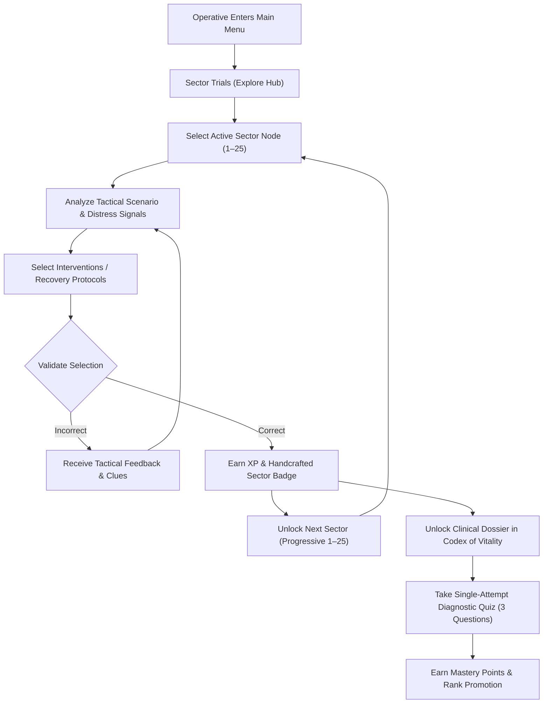
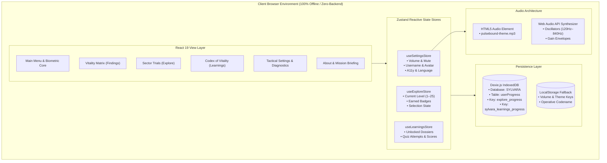

# PULSEBOUND

> **"Forge the flesh. Master the pulse. Unlock your vitality."**

[](https://idealab-hacks.devpost.com/)
[](https://react.dev/)
[](https://www.typescriptlang.org/)
[](https://tailwindcss.com/)
[](https://vitest.dev/)
[](LICENSE)

A dark, cinematic bio-kinetic game fusing exercise physiology, functional biomechanics, sleep architecture, and tactical health decision-making into an immersive progression-based journey.

---

## Table of Contents

- [1. Project Overview](#1-project-overview)
- [2. Problem Statement](#2-problem-statement)
- [3. Inspiration](#3-inspiration)
- [4. IdeaLab Hacks Hackathon Alignment](#4-idealab-hacks-hackathon-alignment)
- [5. What PULSEBOUND Does (Feature Guide)](#5-what-pulsebound-does-feature-guide)
  - [5.1 Main Menu & Biometric Core HUD](#51-main-menu--biometric-core-hud)
  - [5.2 Vitality Matrix (Findings)](#52-vitality-matrix-findings)
  - [5.3 Sector Trials (Explore)](#53-sector-trials-explore)
  - [5.4 Codex of Vitality (Learnings)](#54-codex-of-vitality-learnings)
  - [5.5 Tactical Settings & Diagnostics](#55-tactical-settings--diagnostics)
  - [5.6 About & Mission Briefing](#56-about--mission-briefing)
- [6. Gameplay & Progression Loop](#6-gameplay--progression-loop)
- [7. Visual Identity & Design Philosophy](#7-visual-identity--design-philosophy)
- [8. Media & Sound Design](#8-media--sound-design)
- [9. Technology Stack](#9-technology-stack)
- [10. Architecture & System Design](#10-architecture--system-design)
- [11. 100% Frontend-Only & Offline Capabilities](#11-100-frontend-only--offline-capabilities)
- [12. Installation & Local Development](#12-installation--local-development)
- [13. Testing & Verification Results](#13-testing--verification-results)
- [14. Project Structure](#14-project-structure)
- [15. Health & Educational Safety Disclaimers](#15-health--educational-safety-disclaimers)
- [16. Engineering Challenges & Learnings](#16-engineering-challenges--learnings)
- [17. Future Scope](#17-future-scope)
- [18. Credits & Acknowledgements](#18-credits--acknowledgements)
- [19. License](#19-license)

---

## 1. Project Overview

**PULSEBOUND** is a gamified bio-kinetic education experience created for the **IdeaLab Hacks** hackathon. Built from the ground up to challenge traditional health and fitness software tropes, the application places players into the role of a biological **Operative** tuning and mastering their somatic vessel.

Conventional health applications frequently overwhelm learners with sterile clinical charts, anxiety-inducing calorie counters, or passive walls of text. PULSEBOUND reframes human physiology into an engaging tactical journey. Operatives investigate physiological distress signals, balance aerobic energy pathways, optimize musculoskeletal adaptations, understand sleep architecture, and test their retention in high-stakes diagnostic trials.

PULSEBOUND is designed for fitness enthusiasts, students, athletes, and curious learners who want to understand _how_ their bodies adapt to physical stress and _why_ specific recovery habits support lifelong vitality.

> [!IMPORTANT]
> **Educational Gaming Companion:** PULSEBOUND is strictly an educational game and somatic discovery experience. It is **not** a clinical diagnostic tool, medical prescription software, or therapeutic medical device.

---

## 2. Problem Statement

Modern health education and fitness technology face significant pedagogical barriers:

1. **Hyper-Quantification & Dietary Fatigue:** Traditional fitness platforms compulsively emphasize calorie counting, gram tracking, and restrictive numerical quotas. This focus often creates anxiety, shame, and unsustainable behavioral patterns rather than fostering genuine physiological comprehension.
2. **Dense, Inaccessible Exercise Science:** Valuable research on mitochondrial respiration, tendon collagen remodeling, non-REM slow-wave sleep, and electrolyte osmolarity is locked behind academic jargon that alienates everyday people.
3. **Passive, Unengaging Delivery:** Health articles and clinical pamphlets rely on static lectures, which produce low retention and fail to motivate sustained lifestyle changes.
4. **Disconnection Between Action and Adaptation:** Learners frequently view workouts as disconnected chores rather than realizing that training provides the cellular stimulus while sleep and nutrition supply the adaptive recovery.

### The PULSEBOUND Approach

PULSEBOUND solves these issues through **active, scenario-based gamification**:

- **Tactical Decisions Over Static Articles:** Operatives diagnose real-world scenarios (e.g., central nervous system fatigue during heavy loading, hyponatremia during endurance events) and receive immediate physiological rationales.
- **Portion-Free Whole-Food Modeling:** The Vitality Matrix models qualitative nutrient synergies, anti-inflammatory mechanisms, and metabolic pathways without counting calories or grams.
- **Progressive Mastery Loop:** Operatives earn handcrafted badges across 25 progressive sectors, unlocking corresponding clinical dossiers and single-attempt diagnostic quizzes.

---

## 3. Inspiration

The inspiration behind PULSEBOUND stems from the concept of the **human pulse as the fundamental metric of vitality**. The pulse reflects every physiological demand: cardiovascular stroke volume, sympathetic fight-or-flight arousal, parasympathetic recovery tone, and cellular oxygen transport.

By merging the pulse with an atmospheric, dark blood-red and obsidian aesthetic, PULSEBOUND evokes the tension and focus of high-performance human physiology. The application treats the human body not as a passive patient to be diagnosed, but as an extraordinary bio-mechanical vessel to be forged, conditioned, and understood.

---

## 4. IdeaLab Hacks Hackathon Alignment

**Hackathon:** [IdeaLab Hacks on Devpost](https://idealab-hacks.devpost.com/)  
**Track:** Open-Ended Innovation  
**Chosen Direction:** **Fitness + Health + Health Education + Gamification**

PULSEBOUND was engineered to directly target all four official judging criteria:

| Judging Criterion             | Weight | How PULSEBOUND Addresses It                                                                                                                                                                                                                                         |
| ----------------------------- | ------ | ------------------------------------------------------------------------------------------------------------------------------------------------------------------------------------------------------------------------------------------------------------------- |
| **Creativity & Originality**  | 25%    | Replaces cliché pastel fitness dashboards with a dark, blood-red bio-kinetic aesthetic. Features an animated pulsing Biometric Core, dynamic ECG waveforms, radial orbital sector radars, and an Operative narrative identity.                                      |
| **Execution & Functionality** | 25%    | 100% frontend-only client architecture with zero external servers. Runs offline via IndexedDB (Dexie.js), HTML5 local soundtrack playback, Web Audio synthesizers, and 224 unit tests passing with zero failures.                                                   |
| **Usefulness & Experience**   | 25%    | Teaches actionable exercise science (Zone 2 mitochondrial base, VO2 Max pacing, eccentric tendon loading, slow-wave sleep delta waves, cellular hydration osmolarity) while excluding anxiety-inducing calorie counting. Features full WCAG accessibility controls. |
| **Clarity & Learning**        | 25%    | Uses an active learning loop: tactical scenario analysis → evidence-based rationale → earned badge → unlocked clinical dossier → single-attempt mastery quiz.                                                                                                       |

---

## 5. What PULSEBOUND Does (Feature Guide)

PULSEBOUND comprises six fully implemented, interconnected operational sections:

```
┌────────────────────────────────────────────────────────────────────────┐
│                        MAIN MENU & BIOMETRIC HUD                       │
├─────────────┬─────────────┬─────────────┬─────────────┬────────────────┤
│  FINDINGS   │   EXPLORE   │  LEARNINGS  │  SETTINGS   │     ABOUT      │
│  (Vitality  │   (Sector   │   (Codex    │  (Tactical  │   (Mission     │
│   Matrix)   │   Trials)   │  & Quizzes) │ Diagnostics)│   Briefing)    │
└─────────────┴─────────────┴─────────────┴─────────────┴────────────────┘
```

### 5.1 Main Menu & Biometric Core HUD

The operational gateway to PULSEBOUND:

- **Cinematic Atmosphere:** Fullscreen hardware-accelerated video background (`pulsebound-bg.mp4`) with smooth radial blur, dark overlays, and crimson vignettes.
- **Local Soundtrack Controller:** Integrated HTML5 player for the local theme (`pulsebound-theme.mp3`) with play/pause, volume slider dropdown, and mute toggle.
- **Animated Biometric Core:** Interactive 3D SVG concentric reactor core featuring rotating telemetry rings, an animated pulsing heart, and live ECG telemetry readouts (72 BPM Homeostasis).
- **Operative Status Badge:** Real-time HUD telemetry displaying the Operative's custom codename, active sector level, and earned badge total.
- **Five Primary Portals:** Direct access to _Findings_, _Explore_, _Learnings_, _Settings_, and _About_ with synthesized tactile audio feedback on hover and selection.

### 5.2 Vitality Matrix (Findings)

An interactive bio-synergy simulator designed for qualitative nutritional discovery:

- **Meal & Food Input:** Operatives input meals (e.g., whole grains, lean proteins, colorful vegetables) to trigger real-time biochemical breakdown.
- **12 Qualitative Bio-Markers:** Evaluates nutrient density, anti-inflammatory potential, glycogen re-synthesis factors, and cellular recovery support.
- **Interactive Radial Nutrient Wheel:** Dynamic circular SVG visualization mapping all detected micronutrients in orbital relation to the meal title. Clicking any node opens a deep-dive card detailing physiological mechanisms, bio-available sources, and cellular pathways.
- **Portion-Free & Guilt-Free:** Strictly omits gram counting, portion weighing, and caloric tracking to foster healthy, shame-free relationships with nutritional fuel.
- **Educational Notice:** Clearly reinforces that nutritional synergy models are educational guides, not clinical prescriptions or deficiency tests.

### 5.3 Sector Trials (Explore)

A 25-level orbital simulation game challenging operatives with progressive physiological scenarios:

- **25 Orbital Simulation Sectors:** Arranged across five distinct physiological domains:

| Sectors   | Physiological Domain                               | Core Scientific Topics                                                                                                            |
| --------- | -------------------------------------------------- | --------------------------------------------------------------------------------------------------------------------------------- |
| **01–05** | Cardiovascular Conditioning & Mitochondrial Health | Zone 2 aerobic pacing, mitochondrial biogenesis, VO2 Max intervals, cardiac stroke volume, resting heart rate adaptations.        |
| **06–10** | Musculoskeletal Architecture & Strength            | Progressive overload, mechanical tension, tendon collagen remodeling, kinetic chain bracing, sagittal vs. frontal plane balance.  |
| **11–15** | Neuro-Recovery & Sleep Architecture                | Non-REM slow-wave sleep, delta waves, growth hormone release, REM motor memory consolidation, adenosine clearance, HRV balancing. |
| **16–20** | Metabolic Synergy & Hydration Mechanics            | Electrolyte osmolarity (sodium/potassium/magnesium), cellular hydration, glycogen re-synthesis, post-exercise nutrient timing.    |
| **21–25** | Functional Mobility & Joint Integrity              | Active mobility vs. passive flexibility, end-range strength, synovial joint lubrication, spinal decompression, injury prevention. |

- **Tactical Scenario Cards:** Presents real-world physiological conditions (e.g., acute central nervous system fatigue, dehydration symptoms, post-exercise soreness).
- **Interactive Decision Nodes:** Operatives inspect surrounding nodes via hover tooltips and select scientifically supported protocols.
- **Immediate Evidence-Based Rationale:** Provides clear explanations for why selected interventions succeed or fail.
- **Progression & Badge Unlocks:** Correct solutions award XP, unlock the next sector, and award a permanent handcrafted badge.

### 5.4 Codex of Vitality (Learnings)

A persistent knowledge archive and diagnostic testing suite:

- **25 Unlocked Educational Dossiers:** Each completed sector unlocks its corresponding clinical dossier (`learn_1` through `learn_25`), covering physiological mechanisms, recovery dynamics, nutrition synergies, and clinical red-flag warnings.
- **25 Single-Attempt Diagnostic Quizzes:** Each earned badge unlocks a 3-question mastery challenge (`quiz_1` through `quiz_25`). Questions test practical application and retention with detailed takeaways.
- **Score Tracking & Ranks:** Real-time scoring tracking total points and category completion across all five physiological domains.

### 5.5 Tactical Settings & Diagnostics

System controls and local persistence management:

- **Independent Audio Controls:** Separate volume and mute controls for the background soundtrack and synthesized tactical SFX.
- **Operative Profile:** Editable operative display name and archetype selection synchronized across all stores.
- **Accessibility Controls:** Instant toggles for reduced motion, high-contrast mode, and text size scaling (`small`, `default`, `large`).
- **Local Storage Telemetry:** Live diagnostics displaying Dexie IndexedDB status, active level records, earned badge counts, and quiz statistics.
- **Progress Reset Safeguard:** Multi-step modal confirmation allowing operatives to securely reset their progress with zero data leaks.

### 5.6 About & Mission Briefing

The comprehensive project dossier:

- **Mission & Problem Statement:** Context regarding the IdeaLab Hacks submission and health literacy objectives.
- **Live Architecture Blueprint:** Interactive Mermaid system diagram illustrating component hierarchies and data streams.
- **Curriculum Overview:** Detailed breakdown of the five educational pillars.
- **Future Roadmap:** Distinguishes completed systems from future directions.
- **Safety & Educational Disclaimers:** Explicit clinical notices establishing boundaries between education and medical care.

---

## 6. Gameplay & Progression Loop



Operatives begin at Sector 01 (Beginner) and progressively advance through all 25 sectors. Every victory rewards both in-game progression and real-world health knowledge.

---

## 7. Visual Identity & Design Philosophy

PULSEBOUND features a dark, tactical, blood-red and obsidian color palette engineered to evoke human vitality and focus:

| Color Role             | Hex Code  | Purpose in UI                                        |
| ---------------------- | --------- | ---------------------------------------------------- |
| **Obsidian Black**     | `#050505` | Main viewport canvas, body background                |
| **Abyssal Charcoal**   | `#0B0809` | Glass card surfaces, container backgrounds           |
| **Deep Blood**         | `#4A0008` | Structural element borders, dividers                 |
| **Tactical Crimson**   | `#8B0015` | Secondary highlights, badge frames, orbital lines    |
| **Bio-Red Accent**     | `#C1122B` | Primary action buttons, active sector nodes          |
| **Vitality Highlight** | `#E32636` | Dynamic hover rings, ECG line peaks, glowing borders |
| **Operative White**    | `#F3EEEE` | High-contrast heading typography                     |
| **Muted Telemetry**    | `#A99FA1` | Supporting subtitles, telemetry descriptions         |

### Preserved Design Language & Micro-Interactions

- **Glassmorphism:** Layered panels using `backdrop-blur-xl`, subtle translucent dark backgrounds (`bg-[#140205]/75`), and crimson edge glows.
- **ECG & Biometric Core:** Pulsing heartbeat animations synchronized to human resting heart rate intervals (72 BPM).
- **Radial Orbital Layouts:** Mathematical 2D orbital radars that arrange sector nodes and nutrients in non-overlapping circular coordinates.
- **Motion Transitions:** Hardware-accelerated 60fps spring animations powered by Motion (Framer Motion v12).

---

## 8. Media & Sound Design

### Bundled Background Video

- **Asset Path:** `public/videos/pulsebound-bg.mp4` (4,229,003 bytes)
- **Source:** _Geometric Shapes Night Sky Wallpaper_ (abstract red geometric lines over black background).
- **Behavior:** Hardware-accelerated `<video>` element with `autoPlay`, `loop`, `muted`, `playsInline`, `object-fit: cover`, CSS Gaussian blur (`2.5px`), dark `#050505/45` overlay, and a multi-layered radial vignette to ensure high-contrast typography.

### Bundled Background Soundtrack

- **Asset Path:** `public/audio/pulsebound-theme.mp3` (1,919,260 bytes)
- **Composition:** An atmospheric electronic tactical synth track based on `pulsebreaker.mp3`.
- **Implementation:** Pure local HTML5 `<audio>` player managed in `MusicControl.tsx`. Fully synchronized with `useSettingsStore` for global volume adjustments, mute states, and play/pause controls without external iframe streaming dependencies.

### Bundled Tactical Sound Effects

- **Click Sound:** `public/audio/sfx/click.mp3` (tactile button engagement)
- **Select Sound:** `public/audio/sfx/select.mp3` (sector node selection)
- **Complete Sound:** `public/audio/sfx/complete.mp3` (mission victory fanfare)
- **Web Audio API Synth Fallback:** Integrated Web Audio API synthesizer generates clean sine-wave tones with exponential gain decay (frequencies 120Hz to 840Hz) if HTML5 audio encounters browser autoplay restrictions.

---

## 9. Technology Stack

Every technology listed below is genuinely imported and actively utilized in the application:

| Technology                  | Version / Spec | Role in PULSEBOUND                                                                    |
| --------------------------- | -------------- | ------------------------------------------------------------------------------------- |
| **React**                   | 19.0.0         | Core UI rendering engine utilizing React 19 concurrent features and hooks.            |
| **TypeScript**              | 5.8.2          | Strict type safety across all components, stores, schemas, and test suites.           |
| **Vite**                    | 8.3.8          | Ultra-fast development server, HMR, and Rollup production asset bundler.              |
| **Tailwind CSS**            | 4.0.0          | Utility-first CSS framework configured with custom `@theme` crimson tokens.           |
| **Zustand**                 | 5.0.3          | Centralized, lightweight, decoupled reactive state management.                        |
| **Dexie.js**                | 4.0.11         | IndexedDB wrapper enabling transactional, offline-first browser database persistence. |
| **Motion**                  | 12.4.7         | Hardware-accelerated 60fps springs, exit animations, and layout transitions.          |
| **Lucide React**            | 1.16.0         | Tactical vector iconography used across all HUD interfaces.                           |
| **i18next / React-i18next** | 24.2.2         | Internationalization pipeline supporting localized operative terminology.             |
| **Vitest**                  | 5.1.0          | Fast Vite-native unit test runner for component and store assertions.                 |
| **React Testing Library**   | 16.2.0         | User-centric DOM testing and accessible role verification.                            |
| **JSDOM**                   | 26.0.0         | Simulated browser environment for Vitest test execution.                              |
| **Prettier**                | 3.5.1          | Opinionated code formatter enforcing clean, standardized code style.                  |
| **ESLint**                  | 9.20.1         | Static code analysis enforcing clean code practices and React Hook rules.             |

---

## 10. Architecture & System Design



### Store Responsibilities

- **`useSettingsStore`** (`src/features/settings/store/useSettingsStore.ts`): Manages operative codename, avatar ID, audio volume levels, mute states, text sizing, high-contrast mode, and reduced-motion preferences.
- **`useExploreStore`** (`src/features/explore/store/useExploreStore.ts`): Controls the active sector, orbital node selections, hint status, victory modal states, badge awards, and level transitions.
- **`useLearningsStore`** (`src/features/learnings/store/useLearningsStore.ts`): Manages active learning dossiers, quiz runner flows (intro → questions → feedback → results → review), and persistent attempt histories.

### Database Layer (`src/database/db.ts`)

- Utilizes **Dexie.js** to manage an IndexedDB database with a transactional `userProgress` table.
- Stores progress under stable IDs (`explore_progress`, `sylvara_learnings_progress`).
- Features graceful fallbacks to `localStorage` if IndexedDB is blocked or disabled in private browsing windows.

---

## 11. 100% Frontend-Only & Offline Capabilities

PULSEBOUND is strictly a **client-side, offline-capable application**:

- **No Backend Server:** Zero dependency on Node.js/Express, Python/FastAPI, or server-side microservices.
- **No Cloud Services:** Zero external calls to Supabase, Firebase, AWS, Google Cloud, or third-party database APIs.
- **No Cloud Authentication:** Operative profiles and progress are managed entirely inside the user's browser.
- **Locally Bundled Media:** All videos (`pulsebound-bg.mp4`), soundtracks (`pulsebound-theme.mp3`), and sound effects are bundled locally in `public/`.
- **Complete Offline Functionality:** Once the application static assets are loaded, the entire game—including all 25 sector missions, the Vitality Matrix simulator, 25 clinical dossiers, and 25 diagnostic quizzes—runs without an internet connection.

---

## 12. Installation & Local Development

### Prerequisites

- **Node.js**: `v18.0.0` or higher (`v20+` recommended)
- **npm**: `v9.0.0` or higher

### 1. Clone the Repository

```bash
git clone <repository-url>
cd <repository-folder>
```

### 2. Install Dependencies

```bash
npm install
```

### 3. Start Development Server

```bash
npm run dev
```

Open your browser to `http://localhost:5173/` (or the local port output by Vite).

### 4. Run the Automated Unit Test Suite

```bash
# Run all tests once
npm run test:run

# Run tests in interactive watch mode
npm test
```

### 5. Build for Production

```bash
npm run build
```

Vite and TypeScript will compile and bundle minified static assets into the `dist/` directory.

### 6. Preview the Production Build

```bash
npm run preview
```

### 7. Run Code Quality & Formatting Checks

```bash
# Check code style with Prettier
npm run format:check

# Auto-format files
npm run format

# Run ESLint static analysis
npm run lint
```

---

## 13. Testing & Verification Results

All tests have been executed and verified in the local environment:

```
Test Files  30 passed (30)
Tests       224 passed (224)
Duration    12.90s
```

### Test Suite Breakdown

| Feature Domain                  | Test Suites   | Tests         | Result        | Focus Areas                                                                                                    |
| ------------------------------- | ------------- | ------------- | ------------- | -------------------------------------------------------------------------------------------------------------- |
| **Explore / Sector Trials**     | 5 suites      | 32 tests      | **PASS**      | Radial layouts, scenario validations, hint modals, badge unlocking, store persistence, level progression.      |
| **Findings / Vitality Matrix**  | 7 suites      | 100 tests     | **PASS**      | Meal parsing, 12 bio-markers, radial nutrient wheel rendering, portion-free compliance, zero calorie checks.   |
| **Learnings / Codex & Quizzes** | 8 suites      | 28 tests      | **PASS**      | Clinical dossier unlocking, quiz runner flows, single-attempt locking, scoring tabulation, badge requirements. |
| **Main Menu & HUD**             | 1 suite       | 5 tests       | **PASS**      | Brand heading, single-line tagline, 5 navigation buttons, music controls, sound effects.                       |
| **Tactical Settings**           | 7 suites      | 34 tests      | **PASS**      | Audio volume modulation, accessibility toggles, profile persistence, reset safeguards, i18n synchronization.   |
| **About & Foundations**         | 2 suites      | 25 tests      | **PASS**      | Architecture diagram rendering, smoke tests, curriculum sections, safety disclaimers.                          |
| **Total**                       | **30 suites** | **224 tests** | **100% PASS** | **Zero failures, zero regressions.**                                                                           |

### Production Build Verification

- Command: `npm run build` (`tsc -b && vite build`)
- Result: **Exit Code 0 — Clean Build**
- Output: Production bundles generated in `dist/` with minified JavaScript chunks and optimized CSS.

---

## 14. Project Structure

```
pulsebound/
├── public/
│   ├── audio/
│   │   ├── pulsebound-theme.mp3        # Local theme soundtrack
│   │   └── sfx/                        # Tactical sound effects
│   │       ├── click.mp3
│   │       ├── select.mp3
│   │       └── complete.mp3
│   └── videos/
│       └── pulsebound-bg.mp4           # Cinematic background video
├── src/
│   ├── app/
│   │   ├── App.tsx                     # Top-level application shell
│   │   └── router.tsx                  # React Router v7 configuration (6 routes)
│   ├── database/
│   │   └── db.ts                       # Dexie.js IndexedDB schema & table definitions
│   ├── features/
│   │   ├── about/                      # About & Mission Briefing feature
│   │   │   ├── components/             # ArchitectureDiagram, WhatItTeaches, etc.
│   │   │   └── AboutPage.tsx
│   │   ├── explore/                    # 25-sector radial orbital game system
│   │   │   ├── components/             # Radial radar, LevelObjective, LearningCard
│   │   │   ├── data/                   # levels.ts (25 sectors), badges.ts, etc.
│   │   │   ├── store/                  # useExploreStore.ts, exploreStorage.ts
│   │   │   └── ExplorePage.tsx
│   │   ├── findings/                   # Vitality Matrix bio-synergy simulator
│   │   │   ├── components/             # CentralNutrientWheel, MealProfileSection
│   │   │   ├── engine/                 # mealAnalyzer.ts (12 bio-markers)
│   │   │   └── FindingsPage.tsx
│   │   ├── learnings/                  # Codex of Vitality & diagnostic trials
│   │   │   ├── components/             # QuizRunnerModal, LearningCardGrid
│   │   │   ├── data/                   # quizzes.ts (25 quizzes), learningContent.ts
│   │   │   ├── store/                  # useLearningsStore.ts, learningsStorage.ts
│   │   │   └── LearningsPage.tsx
│   │   ├── main-menu/                  # HUD gateway & Biometric Core
│   │   │   ├── components/             # BiometricCoreVisual, MusicControl, NavButton
│   │   │   └── MainMenu.tsx
│   │   └── settings/                   # Audio, profile & database diagnostics
│   │       ├── components/             # AudioSection, DataProgressSection, etc.
│   │       ├── store/                  # useSettingsStore.ts
│   │       └── SettingsPage.tsx
│   ├── i18n/                           # Internationalization setup and locale files
│   ├── styles/
│   │   └── index.css                   # Custom `@theme` tokens, keyframes, and vignettes
│   ├── tests/
│   │   ├── setup.ts                    # Vitest jest-dom configuration
│   │   └── smoke.test.ts               # Basic environment smoke test
│   └── main.tsx                        # React application entry point
├── index.html                          # HTML5 shell & font configuration
├── package.json                        # Dependencies, scripts, and project metadata
├── tsconfig.json                       # TypeScript compiler options
└── vite.config.ts                      # Vite & Vitest configuration
```

---

## 15. Health & Educational Safety Disclaimers

> [!CAUTION]
>
> ### Medical Disclaimer
>
> PULSEBOUND is an interactive educational software application developed solely for informational, motivational, and educational purposes.
>
> - **Not Medical Advice:** PULSEBOUND does not provide clinical medical advice, diagnose diseases, prescribe medications, or outline individual physical therapy regimens.
> - **Consult Healthcare Professionals:** Always consult a licensed physician, physical therapist, or certified healthcare provider before starting any new exercise program, altering your dietary patterns, or making significant lifestyle changes.
> - **Listen to Your Body:** Exercise principles presented in the game (such as Zone 2 cardio, progressive overload, and mobility drills) are general educational concepts. Physical training must always be adapted to individual health status, mobility limits, and injury history. Never train through acute joint pain, chest pressure, dizziness, or severe discomfort.
> - **No Calorie Tracking:** PULSEBOUND intentionally rejects calorie counting, gram weighing, and restrictive eating protocols to avoid promoting disordered eating behaviors and dietary anxiety.

---

## 16. Engineering Challenges & Learnings

1. **Radial Layout Mathematics:** Designing the 25-sector orbital radar and the dynamic nutrient wheel required precise trigonometric calculations (`Math.cos`, `Math.sin`) to dynamically position nodes across varying viewport sizes without visual collisions.
2. **Deterministic Offline Persistence:** Bridging transient UI state in Zustand with persistent IndexedDB tables via Dexie.js required defensive serialization and graceful `localStorage` fallbacks to ensure uninterrupted progress across private browsing sessions.
3. **Local Media Synchronization Without External Dependencies:** Replacing cloud-streamed audio with a pure local HTML5 audio controller and Web Audio synthesizer fallbacks eliminated external iframe dependencies while maintaining seamless loop playback and volume modulation.
4. **Pedagogical Balance:** Communicating complex biochemical processes—such as mitochondrial biogenesis, delta sleep architecture, and tendon biomechanics—demanded rigorous distillation to keep gameplay fast-paced without diluting scientific integrity.

---

## 17. Future Scope

The following directions represent planned future expansions:

- **Phase 1: Biomechanical Pose Estimation:** Client-side WebAssembly computer vision to provide real-time form feedback and joint-angle tracking for compound movement patterns (squats, hinges, presses).
- **Phase 2: Bio-Telemetry Sensor Integration:** Bluetooth Low Energy (BLE) connectivity for real-time heart rate monitor pairing (chest straps, optical sensors) to measure live Zone 2 cardio intervals during user workouts.
- **Phase 3: Expanded Simulation Sectors:** Additional sector packs exploring advanced sports physiology, altitude adaptation, and heat acclimation.

---

## 18. Credits & Acknowledgements

- **IdeaLab Hacks:** Organizers and mentors of the IdeaLab Hacks hackathon for providing the open-ended platform to build impactful software.
- **Background Video Asset:** _Geometric Shapes Night Sky Wallpaper_ (`pulsebound-bg.mp4`), licensed for creative digital art use.
- **Background Soundtrack:** _PULSEBOUND Vitality Theme_ (`pulsebound-theme.mp3`), an electronic ambient composition based on `pulsebreaker.mp3`.
- **Iconography:** [Lucide React](https://lucide.dev/) for their tactical and clinical icon set.
- **Typography:** Google Fonts for _Cinzel_ (branding & titles) and _Plus Jakarta Sans_ (interface telemetry).

---

## 19. License

This project is licensed under the **MIT License** — see the [LICENSE](LICENSE) file for details. Built for **IdeaLab Hacks 2026**.
